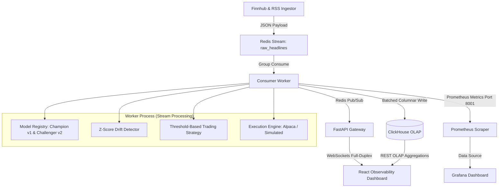

# SentiStream 🚀

**SentiStream** is a real-time, event-driven MLOps sentiment analytics and quantitative paper trading pipeline for financial headlines. It demonstrates high-performance data engineering, machine learning service deployment, and real-time observability.

The system processes financial news feeds through an event queue, routes them deterministically across two ONNX FinBERT version slots, checks for statistical sentiment drift, and executes quantitative trading strategies (Long-Only or Long-Short/Short-Selling) using a simulator or Alpaca's paper-trading API.

---

## 💎 Core Features

### 1. Event-Driven Real-time Pipeline
* **Async News Ingestor (`ingestor.py`)**: Polls Finnhub's financial news API and falls back to MarketWatch and Yahoo Finance RSS feeds on API failures. Uses a deterministic UUID derived from headline text and ticker for deduplication.
* **Broker Queue (Redis Streams)**: Buffers raw ingest payloads in the `raw_headlines` stream to decouple ingestion from inference.
* **Consumer Worker (`worker.py`)**: Consumes the stream, routes text to versioned INT8-quantized FinBERT ONNX models, updates Z-score drift stats, evaluates trading signals, executes simulated/Alpaca trades, and persists results.

### 2. ONNX Routing Telemetry
* Routes headlines across version slots (`v1` and `v2`) using CPU ONNX Runtime.
* Implements a deterministic **80/20 split** based on the headline UUID:
  `Model Version = v1 if int(headline_id[:8], 16) % 10 < 8 else v2`
  This keeps slot assignment stable across worker restarts and DLQ replays. If versioned artifacts are absent, both slots are copied from the same base model; the current dashboard reports routing counts and latency, not model-quality A/B results.

### 3. Quantitative Trading Strategies
* **Strategy Modes**: Supports **Long-Only** and **Long-Short (Short Selling)** modes. Dashboard write controls are disabled by default and remain disabled in production until authenticated controls exist.
* **Long-Only Mode**:
  * **Confidently Positive** (sentiment score $\ge 0.75$): Buy an allocation equal to 5% of net portfolio value.
  * **Confidently Negative** (sentiment score $\ge 0.75$): Sell/liquidate the entire ticker position (no shorting).
* **Long-Short Mode**:
  * **Confidently Positive**: Cover any existing short position completely. If flat or long, add to/open a long position (5% allocation cost).
  * **Confidently Negative**: Liquidate any existing long position completely. If flat or short, open/scale into a short position (5% allocation proceeds added to cash, shares become negative).
* **Cooldown limit**: Enforces a strict 60-second cooldown period per ticker.
* **Simulated & Alpaca Paper Engines**: Supports a local simulated engine or orders to the Alpaca paper-trading API.
* **Capital-Depletion Validation**: Dispatches WebSocket notifications for out-of-cash errors.

### 4. Trade Ledger Reconstruction
* Reconstructs the portfolio cash, position ledger, realized/unrealized P&L, and win-rate metrics directly from ClickHouse trade history using `PortfolioService`.
* Handles short sale proceeds (added to cash at execution time) and short covering costs (subtracted from cash) without double-counting position liabilities.
* The dashboard stores periodic equity and holdings marks in ClickHouse and shows the quote source, observation count, and sampled maximum drawdown. Finnhub marks are labeled live; fallback marks are labeled simulated.
* The worker records a Finnhub SPY quote with each portfolio snapshot. The analytics API compares portfolio and SPY returns over the same aligned observation window, and only includes live benchmark prices with live or cash-only portfolio marks. Fallback or unknown marks are excluded; the dashboard waits for at least two eligible observations before reporting relative performance.

### 5. MLOps Telemetry (Prometheus & Grafana)
* Tracks tokenization/inference latency histograms, processed throughput count, rolling Z-score sentiment drift, portfolio cash/valuation, and stream backlogs.
* Starts a background Prometheus metrics server on port `8001` inside the worker process, avoiding external gateway dependencies.
* Integrates a pre-configured Grafana dashboard utilizing Prometheus metrics out-of-the-box.

### 6. Premium Glassmorphic Web UI
* Displays live ticker news streams with distinct, version-specific badges (`V1` / `V2`) indicating which model performed inference.
* Shows routing-slot counts and latency percentiles. It does not claim a model-quality comparison until distinct artifacts and labeled evaluations are available.
* Formats negative position shares as `SHORT` (e.g., `10 SHORT`) with distinct amber accents (`var(--color-drift)`) to represent short liabilities.
* Displays a header panel containing Net Portfolio Value, Cash Balance, Realized P&L, Unrealized P&L, and Win-Rate metrics using beautiful, custom telemetry cards and inline SVGs.

---

## 🚀 Pipeline Architecture



---

## 🛠️ Local Installation & Setup

### Prerequisites
* Docker Engine and Docker Compose v2
* Python 3.11+ only if you need to export model assets locally

### 1. Configure the environment
```bash
cp .env.example .env
```
Set `FINNHUB_API_KEY` if you want Finnhub ingestion and quotes. Keep `ENABLE_TEST_ENDPOINTS` and `ENABLE_DASHBOARD_CONTROLS` false for a public deployment. The default ClickHouse password is for local development; replace it before hosting.

### 2. Prepare model assets
Model binaries are deliberately excluded from Git. From the project root, install the ML dependencies and export the ONNX model:
```bash
python3 -m venv venv
source venv/bin/activate
pip install -r backend/requirements.txt
python backend/ml/export_onnx.py
```
The runtime expects `models/finbert-int8.onnx` and the tokenizer files under `models/finbert-onnx/`. Startup makes `v1` and `v2` routing-slot copies from the base model when versioned files are absent; the slots are not a model-quality A/B experiment.

### 3. Start the complete stack
```bash
docker compose up --build -d
```
Open `https://localhost` (the local Caddy certificate may require a browser trust exception). The stack includes the API, inference worker, news ingestor, frontend, Redis, ClickHouse, and Caddy. Prometheus and Grafana are optional:
```bash
docker compose --profile observability up --build -d
```
The API is available to the host only at `127.0.0.1:8000` for local tools. Grafana is bound to `127.0.0.1:3000` and Prometheus to `127.0.0.1:9090`; they are not exposed to the public network. For local browser tests that inject headlines, set `ENABLE_TEST_ENDPOINTS=true` in `.env` while `APP_ENV=development`. Do not enable this in production.

### Public deployment
Use a Linux VM with Docker Compose for the first hosted demo. Copy the repository and model assets to the VM, configure `.env` with a real `SENTISTREAM_DOMAIN`, a strong ClickHouse password, and any external API keys, then run:
```bash
docker compose -f docker-compose.yml -f docker-compose.production.yml up --build -d
```
Point the domain's DNS record at the VM and allow inbound TCP ports 80 and 443. Caddy terminates HTTPS; Redis, ClickHouse, API, Prometheus, and Grafana remain internal (the observability ports bind to loopback). The production override disables test injection and dashboard write controls. Back up the named ClickHouse and Redis volumes.

---

## 🧪 Testing & Seeding Guide

### 1. Run Unit & Integration Tests
Executes Pytest suites covering trading, strategy cooldowns, drift alert algorithms, and database ledger replaying:
```bash
PYTHONPATH=backend ./venv/bin/pytest
```

### 2. Seed Mock Transactions & Headlines
Injects real-time financial headlines into Redis to test pipeline execution and trigger strategy trades:
```bash
PYTHONPATH=backend ./venv/bin/python scripts/seed_test_data.py --mode=trades
```

### 3. E2E Browser Testing (Playwright)
Validates frontend components, WebSocket streaming updates, capital warning banners, and reconnection resiliency:
```bash
cd frontend
npx playwright test
```

### 4. Load Testing (Locust)
Simulates concurrent stream writes and high API endpoint query load:
```bash
./venv/bin/locust -f backend/tests/locustfile.py --headless -u 10 -r 2 --run-time 5m --host http://localhost:8000
```

---

## 📐 Architectural Decisions (ADRs)

For a detailed design log, refer to [DECISIONS.md](DECISIONS.md):
1. **Process-Local Price Feed Singletons**: Avoids shared memory/DB lookups for live quotes. Each backend process uses an independent 30s cache.
2. **Lightweight HTTP Server for Worker Telemetry**: Starts a Prometheus exporter on port `8001` in the worker process thread, removing Pushgateway dependencies.
3. **Bypassing `/metrics` tracking**: Excludes scraping routes from Gateway request middleware to avoid skewing real-user traffic metrics.
4. **Z-Score Resetting Rules**: Quiet tickers (no headlines for 60s) reset their sentiment rolling standard-deviation metrics to `0.0` to avoid stale indicators.
5. **Dual ONNX Startup Sessions**: Pre-loads both v1 and v2 models in memory (~210MB footprint) to achieve stable, sub-50ms p99 latency benchmarks from the first request.
6. **Position Sizing and Scaling**: Allows consecutive buys/sells up to cash limits once the cooldown expires, rather than enforcing a flat-to-active rule.
7. **Short-Covering Liquidation Symmetry**: Covers short positions (or liquidates long positions) completely when opposing sentiment triggers occur to mitigate risk.

---

## Implementation roadmap

Track completed and pending product, reliability, analytics, and deployment work in [IMPLEMENTATION_ROADMAP.md](IMPLEMENTATION_ROADMAP.md). Architectural and code choices are recorded in [DECISIONS.md](DECISIONS.md).
